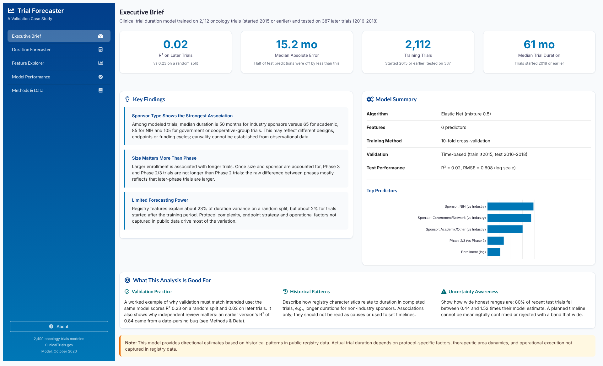
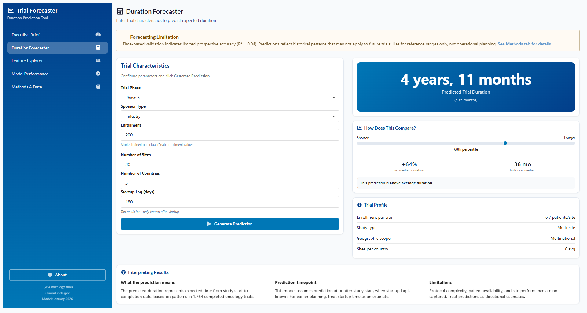
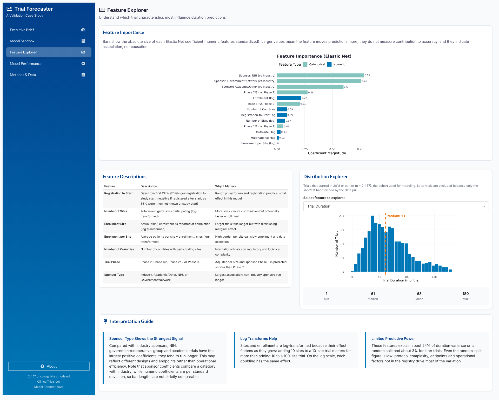
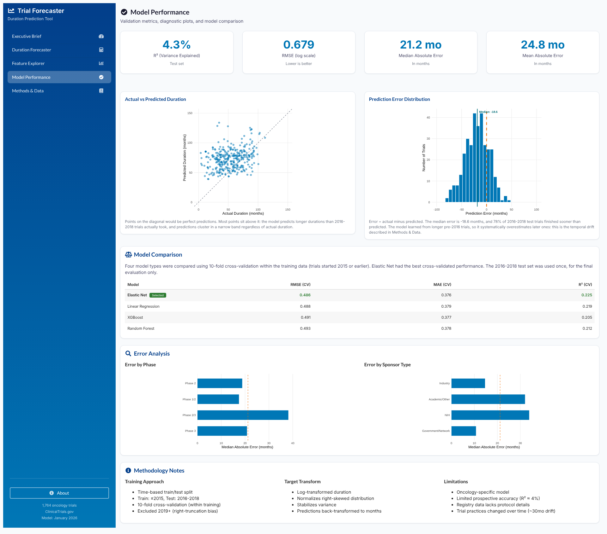
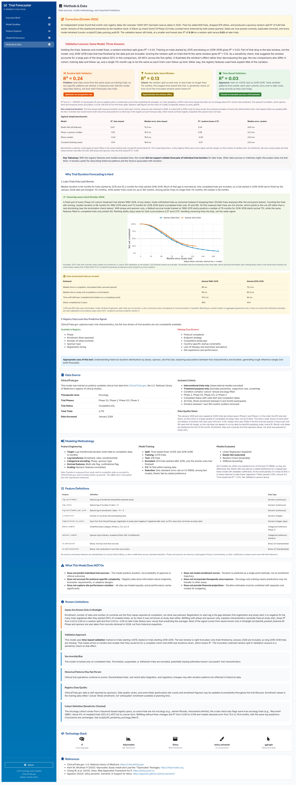

# Clinical Trial Duration Forecaster

*A portfolio case study in validation-first analytics using ClinicalTrials.gov oncology trials*

    

------------------------------------------------------------------------

## Overview

This project demonstrates **end-to-end predictive analytics** for clinical trial duration modeling—and why **validation strategy matters more than model selection**.

Initial random validation suggested strong performance (**R² = 0.84**). A time-based validation split—appropriate for prospective use—revealed minimal predictive power (**R² ≈ 0.04**).

**The finding is the insight:** realistic validation prevents overconfident forecasting from registry data.

------------------------------------------------------------------------

## Live Dashboard

## 🔗 **Interactive dashboard (ShinyApps.io):** [Clinical Trial Duration Forecaster](https://0l6jpd-steven-ponce.shinyapps.io/clinical-trial-forecaster/)

## Key Finding

| Validation Approach | Test R² | Test Median Absolute Error | Interpretation |
|----|---:|---:|----|
| Random Split | 0.84 | 7.4 months | Over-optimistic (temporal leakage) |
| **Time-Based Split** | **0.04** | **21.2 months** | **Honest prospective estimate** |

### Why the gap?

-   **Temporal drift:** Trial durations shortened substantially across eras (median \~82 → \~53 months in this dataset)
-   **Registry limitations:** ClinicalTrials.gov lacks protocol complexity, endpoint strategy, and competitive dynamics
-   **Evolving practices:** Adaptive designs, biomarker selection, and regulatory changes altered duration drivers over time

This is not "model failure"—it shows why validation must match the intended decision context.

------------------------------------------------------------------------

## Dashboard Preview

### Executive Brief

 *Key metrics with honest R² = 0.04 and model summary*

### Duration Forecaster (Scenario Sandbox)

 *Interactive tool showing how the model behaves—not for operational planning*

### Feature Explorer

 *Coefficient analysis and feature distributions*

### Model Performance

 *Diagnostic plots with actual error analysis by phase and sponsor*

### Methods & Data

 *Validation Lessons panel explaining why metrics can mislead*

------------------------------------------------------------------------

## Purpose (and Boundaries)

The dashboard helps answer:

-   How do registry-level trial characteristics relate to historical duration?
-   What are the limits of registry-based forecasting in oncology?
-   How does validation choice change conclusions?
-   Where does the model fail, and why?

**This tool is intended for methodology and pattern understanding—not operational planning.**

------------------------------------------------------------------------

## What This Dashboard Does *Not* Do

To avoid overreach, this project does **not**:

-   Provide reliable prospective duration forecasts for planning
-   Recommend protocol or design decisions
-   Predict clinical success, approvals, or outcomes
-   Substitute for protocol-level feasibility analysis

All results are conditional on historical registry patterns that may not persist.

------------------------------------------------------------------------

## Analytical Framework

### Data Pipeline

1.  **Acquisition:** ClinicalTrials.gov API v2 (pulled January 2026)
2.  **Cohort:** Interventional, treatment-purpose oncology trials (keyword-based condition query; imperfect)
3.  **Outcome:** Duration in months from **Start Date → Completion Date** (includes follow-up; not equivalent to LPLV)
4.  **Features:** Enrollment, sites, countries, sponsor type, phase, derived ratios/log transforms
5.  **Model:** **Elastic Net (glmnet)** via tidymodels

### Validation Strategy (Time-Based)

```         
Training:  Trials with start date ≤2015 (n=546)
Test:      Trials with start date 2016–2018 (n=340)
Excluded:  Trials with start date ≥2019 (n=878, right-truncation bias)
```

Trials starting in 2019+ were excluded because only shorter-duration studies from that era are fully completed and present in the dataset as of the January 2026 data pull. Including them would bias observed durations downward.

### Model Comparison (CV within training data)

| Model             |     CV R² | CV RMSE (log-months) |
|-------------------|----------:|---------------------:|
| **Elastic Net**   | **0.225** |            **0.486** |
| Linear Regression |     0.219 |                0.488 |
| Random Forest     |     0.212 |                0.493 |
| XGBoost           |     0.205 |                0.491 |

**Final model used in the dashboard:** Elastic Net (glmnet)

------------------------------------------------------------------------

## Data Sources

-   **ClinicalTrials.gov** (U.S. National Library of Medicine)
-   **API v2**, accessed January 2026

### Inclusion Criteria

-   Interventional studies
-   Primary purpose: treatment
-   Phase 1/2, 2, 2/3, or 3
-   Completed with valid start/completion dates
-   Actual enrollment (final posted value)
-   Duration 1–180 months

### Data Quality Notes

-   Registry fields are self-reported and updated over time
-   Historical snapshots are not available in this build
-   Oncology cohort defined via keyword-based registry fields (imperfect)

------------------------------------------------------------------------

## Key Design Principles

-   **Validation-first thinking** — Match strategy to use case
-   **Transparency over performance** — Report honest metrics
-   **Explainability over complexity** — Linear model over black box
-   **Appropriate restraint** — Document what the tool cannot do
-   **Decision support, not automation** — Inform, don't prescribe

------------------------------------------------------------------------

## Limitations

-   Oncology cohort defined via keyword-based registry fields (imperfect)
-   Registry fields are self-reported and updated over time
-   Limited prospective predictive power (R² ≈ 0.04)
-   Temporal drift may continue beyond observed patterns
-   Survivorship bias (completed trials only)

------------------------------------------------------------------------

## Repository Structure

```         
clinical-trial-forecaster/
├── app/
│   ├── app.R                    # Entry point
│   ├── global.R                 # Data loading, metrics, helpers
│   ├── ui.R                     # Main UI definition (moved from R/)
│   ├── DESCRIPTION              # Package dependencies for shinyapps.io
│   ├── modules/
│   │   ├── mod_executive_brief.R
│   │   ├── mod_forecaster.R
│   │   ├── mod_features.R
│   │   ├── mod_performance.R
│   │   └── mod_methods.R
│   ├── models/                  # Trained model artifacts
│   │   ├── final_workflow.rds
│   │   ├── feature_importance.rds
│   │   ├── model_comparison.csv
│   │   └── test_predictions.csv
│   ├── data-raw/
│   │   ├── modeling/            # Feature table read by the app
│   │   └── cache/               # Jan 2026 ClinicalTrials.gov snapshot (not deployed)
│   ├── docs/                    # Diagnostic plots (not deployed)
│   └── www/
│       └── styles.css
├── scripts/                     # Data pipeline
│   ├── 00_setup.R
│   ├── 01_data_acquisition.R
│   ├── 02_data_exploration.R
│   ├── 03_feature_engineering.R
│   └── 04_modeling.R
└── screenshots/
```

------------------------------------------------------------------------

## Technical Stack

-   **Language:** R
-   **Framework:** Shiny (modular architecture)
-   **UI Components:** shiny.semantic (Appsilon)
-   **Visualization:** ggplot2, ggiraph, reactable
-   **ML Framework:** tidymodels
-   **Deployment:** ShinyApps.io

------------------------------------------------------------------------

## License

This project is released under the **MIT License**.

------------------------------------------------------------------------

## Disclaimer

This project is for **educational and portfolio purposes only**.

It does not constitute clinical, operational, or planning advice. All parameters are derived from publicly available registry data. No representation is made regarding applicability to specific trial contexts.

------------------------------------------------------------------------

## Contact

**Steven Ponce** Data Analyst \| R Shiny Developer \| Business Intelligence Specialist

🔗 **Portfolio Website**: [stevenponce.netlify.app](https://stevenponce.netlify.app/projects.html) 🐙 **GitHub**: [\@poncest](https://github.com/poncest) 💼 **LinkedIn**: [stevenponce](https://www.linkedin.com/in/stevenponce/) 🦋 **Bluesky**: [\@sponce1](https://bsky.app/profile/sponce1.bsky.social)

------------------------------------------------------------------------

*Prepared by Steven Ponce as part of a professional analytics portfolio.* *Demonstrating that honest validation findings—even when they reveal limitations—are more valuable than inflated metrics.*
